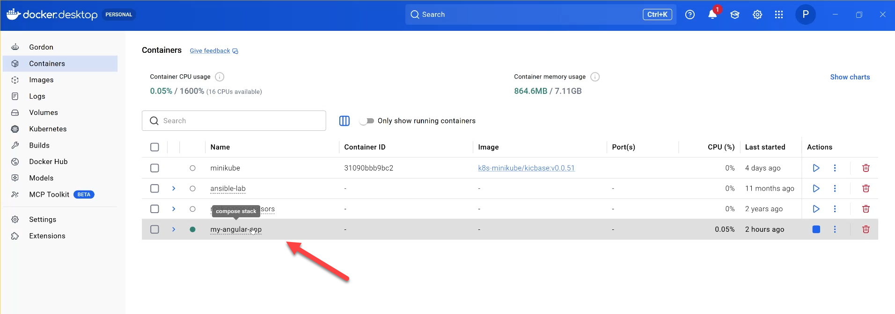
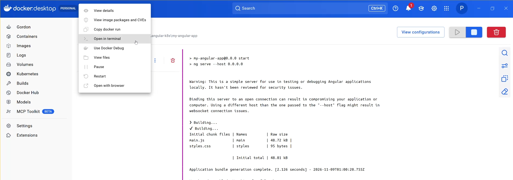
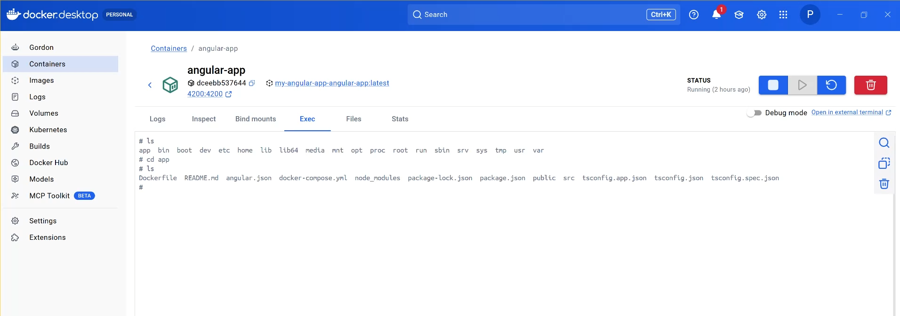

# How to Access an Angular Container Terminal Using Docker Desktop
This guide explains how to access a running Angular container using Docker Desktop. You can execute Linux commands, inspect project files, and troubleshoot your application.

## Go the the Containers Tab

## Open the Terminal

## Executes Linix Commands

## Common Linux Commands

| Command            | Description                                           |
| ------------------ | ----------------------------------------------------- |
| `pwd`              | Display the current working directory.                |
| `ls`               | List files and directories.                           |
| `ls -la`           | List all files, including hidden files, with details. |
| `cd app`           | Navigate to the app directory.                        |
| `cd ..`            | Move up one directory.                                |
| `mkdir test`       | Create a directory named test.                        |
| `cat package.json` | Display the contents of package.json.                 |
| `node --version`   | Display the Node.js version.                          |
| `npm --version`    | Display the npm version.                              |
| `ng version`       | Display Angular CLI information.                      |
| `exit`             | Exit the container terminal.                          |

[README](./README.md)