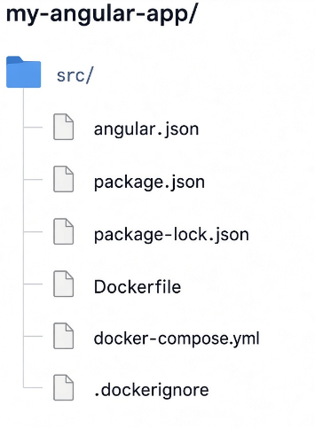
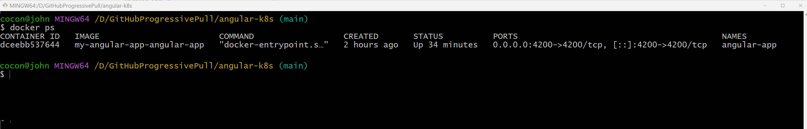

# angular-k8s

## Project Structure



## Build Container

```bash
docker-compose build
```
or

```bash
docker compose build
```

## Start Application
```bash
docker compose up
```
or detached mode:

```bash
docker compose up -d
```
## Access Angular

Open:

[http://localhost:4200](http://localhost:4200)

You should see the Angular application running from Docker.

## Verify Container

List running containers:

```bash
docker ps
```
Expected output:



## Table of Contents
* [Dockerfile Explanation](./Dockerfile_Explanation.md)