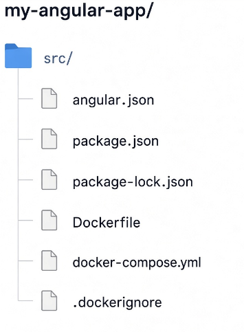
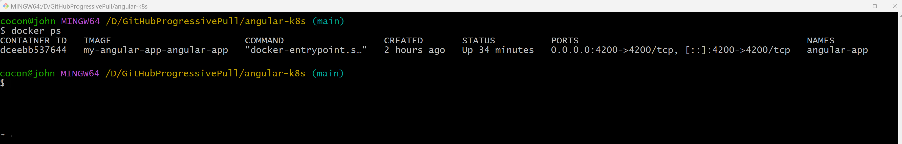

# angular-k8s

By John Smith

## Project Structure



Change directory to my-angular-app

```bash
cd my-angular-app
```

## Build Container

```bash
docker-compose build
```
or

```bash
docker compose build
```

## Start Application
```bash
docker compose up
```
or detached mode:

```bash
docker compose up -d
```
## Access Angular

Open:

[http://localhost:4200](http://localhost:4200)

You should see the Angular application running from Docker.

## Verify Container

List running containers:

```bash
docker ps
```
Expected output:



# Docker Hub repository information

## Repository name
my-angular-app      

## Description
A containerized Angular web application built with Angular and deployed using Docker.    

## Category
WEB SERVER

## Overview
# My Angular Application

## Overview

My Angular Application is a modern frontend web application developed using the Angular framework. The application is containerized using Docker to simplify deployment, testing, and development across different environments.

## Technologies

- Angular – Frontend application framework
- TypeScript – Application programming language
- HTML5 and CSS3 – User interface and styling
- Node.js and npm – Development environment and package management
- Docker – Containerization and deployment

## Features

- Component-based Angular architecture
- Responsive web application structure
- Docker container support
- Portable and consistent deployment
- Ready for integration with Kubernetes

## Getting Started

The application can be built into a Docker image and published to Docker Hub for deployment on other systems.

## Purpose

This project demonstrates building, containerizing, and deploying an Angular application using Docker and Kubernetes.

# Recommended Docker Hub tags
When you publish your images, I recommend these tags:

| Tag	            | Purpose                  |
|-----------------|--------------------------|
| latest          |	Latest stable build      |
| 1.0.0	          | First release            |
| dev	            | Development build        |

# Example Docker Hub image
Based on your GitHub/Docker Hub username:

```bash
progressivepull/my-angular-app:latest
```

# Table of Contents
* [Dockerfile Explanation](./Dockerfile_Explanation.md)
* [How to Access an Angular Container Terminal Using Docker Desktop](./Access_Container_Terminal.md)

